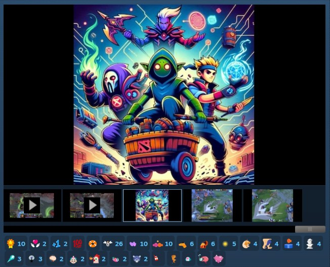

# Open Hyper AI (OHA) - Dota 2 Bot Scripts

**The most feature-rich custom bot script for Dota 2.** Play against bots that actually fight, farm, push, and use items intelligently.

> **To play:** Create a **Custom Lobby** and select **Local Host** as the server location. Bots should have names ending with **".OHA"** when installed correctly.

[Steam Workshop](https://steamcommunity.com/sharedfiles/filedetails/?id=3246316298) | [GitHub](https://github.com/forest0xia/dota2bot-OpenHyperAI) | [Feature Requests](https://github.com/forest0xia/dota2bot-OpenHyperAI/issues?q=is%3Aissue+is%3Aopen+%5BFeature+request%5D)



---

## What Makes This Different

-   **127 heroes supported** on Patch 7.41/7.41a - including Largo, Kez, Ringmaster, Invoker, Techies, Meepo, Lone Druid, and more
-   **Bots actually play the game** - they lane, gank, push towers, defend, farm jungle, take Roshan, and use active items
-   **Dynamic difficulty (FretBots mode)** - bots get unfair bonuses that scale with difficulty for a real challenge
-   **Bots communicate** - they announce pushes, defends, Roshan, and respond to your pings with "On my way!" (in 4 languages)
-   **10+ Game modes supported** - All pick, Turbo, All random, Captain mode, 1v1 mid, All Random Deathmatch, etc.
-   **Customizable everything** - bot names, roles, hero picks, bans, item builds, skill builds, and more
-   **AI Chatbot** - bots chat like real (toxic) players (FretBots mode; auto-started where the engine loads this fork's addon scripts, see Quick Start)
-   **All roles supported** - deterministic position 1-5 lane assignment

---

## Quick Start

1. Subscribe on [Steam Workshop](https://steamcommunity.com/sharedfiles/filedetails/?id=3246316298)
2. Create a **Custom Lobby** with **Local Host** server
3. Start the game - bots auto-pick and play

For **FretBots mode** (harder bots, neutral items, chatbot): [Manual installation guide](https://github.com/forest0xia/dota2bot-OpenHyperAI/discussions/68). This fork starts FretBots automatically at hero selection when `vscripts/game` is linked to the repo (the fork installers do this) - the difficulty vote appears in-game, no console command needed. If only `bots/` is linked (Workshop-style install), run it once per game from the console with cheats enabled: `sv_cheats 1; script_reload_code bots/fretbots`. Auto-start opt-out: `Customize.Enable_FretBots_By_Default = false` in [Customize/general.lua](bots/Customize/general.lua).

---

## Install This Fork (LLM build)

The Workshop copy is upstream Open Hyper AI. This fork adds the LLM advisor, so it's installed from a git clone instead of a subscription.

**1. Clone the fork** somewhere outside the Steam folder:

```
git clone https://github.com/Maxxoto/Dota-OpenHyperAI-Agent.git
```

**2. Link (or copy) `bots/` and `game/` into `vscripts`.** A symlink keeps the clone and the game in sync, so a `git pull` updates your bots. All install targets sit under your Steam root:

| OS      | Steam root                                 | Install target                                                |
| ------- | ------------------------------------------ | ------------------------------------------------------------- |
| Windows | `C:\Program Files (x86)\Steam`             | `...\steamapps\common\dota 2 beta\game\dota\scripts\vscripts` |
| macOS   | `~/Library/Application Support/Steam`      | `.../steamapps/common/dota 2 beta/game/dota/scripts/vscripts` |
| Linux   | `~/.steam/steam` or `~/.local/share/Steam` | `.../steamapps/common/dota 2 beta/game/dota/scripts/vscripts` |

Windows (Developer Mode on, or an elevated Command Prompt, since `mklink` needs one of the two):

```
mklink /d "C:\Program Files (x86)\Steam\steamapps\common\dota 2 beta\game\dota\scripts\vscripts\bots" "C:\src\Dota-OpenHyperAI-Agent\bots"
mklink /d "C:\Program Files (x86)\Steam\steamapps\common\dota 2 beta\game\dota\scripts\vscripts\game" "C:\src\Dota-OpenHyperAI-Agent\game"
```

macOS:

```bash
V="$HOME/Library/Application Support/Steam/steamapps/common/dota 2 beta/game/dota/scripts/vscripts"
ln -s "$HOME/src/Dota-OpenHyperAI-Agent/bots" "$V/bots"
ln -s "$HOME/src/Dota-OpenHyperAI-Agent/game" "$V/game"
```

Linux:

```bash
V="$HOME/.steam/steam/steamapps/common/dota 2 beta/game/dota/scripts/vscripts"
ln -s "$HOME/src/Dota-OpenHyperAI-Agent/bots" "$V/bots"
ln -s "$HOME/src/Dota-OpenHyperAI-Agent/game" "$V/game"
```

Copying works too if you'd rather not touch symlinks: `xcopy /E` on Windows, `cp -R` elsewhere, with the same source and target paths.

One caveat before you link: `vscripts/game` is a stock Valve folder and this fork ships its own copy of it (engine glue plus the permanent `Customize` tier). Rename the existing one to `game_old_<date>` first so you can restore it.

**3. Turn on the LLM advisor** with the [setup steps below](#setup).

**Quick way (Windows):** run `bots\Install-to-vscript\quick-install-oha.bat` from your clone, as Administrator. It auto-detects your Steam install (registry), links `bots/` (junction fallback if symlinks are blocked), copies `Customize` to the permanent game tier, and can enable the LLM advisor for you: it asks for your Groq key and writes it into `<vscripts>/game/Customize/llm.lua` plus flips `Allow_LLM_Advisor = true` in the game-tier copy — the key never lands in the repo. The Linux/macOS scripts in that folder still target the Workshop copy; use the manual links below there.

---

## In-Game Commands

| Command      | Description                                                    |
| ------------ | -------------------------------------------------------------- |
| `!pos X`     | Swap your role with a bot (e.g., `!pos 2` for mid)             |
| `!Xpos Y`    | Reassign bot positions (e.g., `!3pos 5` = 3rd bot plays pos 5) |
| `!pick HERO` | Pick a hero (`!pick sniper`, or `/all !pick sniper` for enemy) |
| `!ban HERO`  | Ban a hero from being picked                                   |
| `!sp XX`     | Set bot language (`en`, `zh`, `ru`, `ja`)                      |

Use [internal hero names](https://github.com/forest0xia/dota2bot-OpenHyperAI/discussions/71) if short names overlap (e.g., `!pick npc_dota_hero_keeper_of_the_light`). Batch commands work too: `!pick io; !ban sniper`.

---

## LLM Advisor (Experimental)

During All Pick hero selection the bots can ask Groq (an OpenAI-compatible API, default model `qwen/qwen3.8-27b`) which heroes to pick and ban. They spend at most two calls per game, and the first pick waits a bounded 6 seconds for an answer. Validated picks merge into the existing matchup scoring:

```
score = base x (1 - alpha) + weight x alpha
```

`alpha` is capped at 0.5, so the model re-ranks candidates but can never force an unpickable hero. Bans, the weak-hero cap, and your `!pick` / `!ban` chat commands always win.

At hero spawn the same directive supplies a skill order (`q`/`w`/`e`/`r`), talents, and an item build, applied as a prefix in front of each hero's default build. Everything runs async and fails safe: LLM off, slow, or malformed means exactly the previous bot behavior.

**Status:** verified offline only. `tstl` build clean, 36/36 Node tests, 13/13 LuaJIT adapter smoke tests, and a live Groq round-trip through [test/live_roundtrip.lua](test/live_roundtrip.lua) against `qwen/qwen3.8-27b`. Not yet verified inside an actual Dota lobby, and item suggestions are structurally validated only. Design notes: [LLM adaptive bots design doc](docs/superpowers/specs/2026-10-11-llm-adaptive-bots-design.md).

| Command                | Description                                                                            |
| ---------------------- | -------------------------------------------------------------------------------------- |
| `!llm status`          | Master switch, model, call budget used, and what's in flight                           |
| `!llm on` / `!llm off` | Enable or disable the advisor for this session only                                    |
| `!llm selftest`        | Run the offline validator self-test (canned responses, no network) and print pass/fail |

`!llm on` can't override the master switch in `general.lua`. It only undoes an `!llm off` from the same game.

### Adaptive Strategy

Once the game is running, one bot asks the model for a macro read every 5 minutes: a stance plus push pressure per lane. That stops at 8 asks per game, and the answer never replaces Valve's desire table.

Each returned value is a multiplier clamped to 0..1 and merged into the existing desire under a hard alpha cap. Out-of-range numbers are clamped, unknown keys dropped, so a bad answer can only nudge play.

Every accepted ask prints one line in chat and the message feed:

```
[OHA-LLM] strategy @12m: push, mid 0.7 (ask 3/8)
```

Set `Phases.desire = false` to turn it off. With the checkpoint off, bot play stays identical to upstream.

### Natural-Language Control

Talk to a bot like a teammate: `axe go safelane`, `mid come safe`. No `!` prefix, no menu.

The model returns one of two tool calls, `swap_lane` (lane word: safe, mid, off) or `swap_position` (pos 1-5). The router checks each call against the live roster before anything moves. Teammate bots only: a human slot or an enemy hero gets rejected, with an audit line such as `[OHA-LLM] chat tool rejected: hero-not-teammate`.

Swaps are capped at 4 per game with a 30 second cooldown between them. A message only reaches the model when it names a hero and a command word, so ordinary banter costs no calls. The `!pos`, `!3pos`, `!pick` and `!ban` commands still work exactly as before.

### Bot Identity

Every bot gets a seeded persona, built once per game from its hero and the match clock: a handle (`axe_enjoyer`), an archetype (cocky, stoic, chatty), a voice, and catchphrases. That persona speaks the bot's chat replies and its compliance lines, so a suggestion sounds like a player on your team instead of a system message.

Identity is expression only. It changes how a bot talks, never what it picks, builds or where it walks. Turn chat off and the personas go quiet with it, with zero effect on play.

### Verifying It Runs

-   During hero selection the fork draws `[OHA-LLM] FORK ACTIVE gate=ON|OFF (...)` as an **on-screen overlay** (top-right) every draft frame, and prints it to console when console prints are visible. **No overlay = the lobby is not running this fork** — stale clone or Workshop copy. `git pull`, then start a fresh lobby.
-   If the overlay says `gate=OFF`, fix the two flags it names (`game/Customize/general.lua` and `game/Customize/llm.lua`).
-   With the gate on, watch for `[OHA-LLM]` ask/accept lines during hero selection — the draft asks only run there. When each hero with an LLM build spawns, its skill order and opening items are announced in chat and the message feed (e.g. `[OHA-LLM] build axe (pos 3): q-w-e-r | blink, bkb, heart +2`).
-   The same spawn announces the bot's persona: `[OHA-LLM] identity axe_enjoyer: cocky (chattiness 0.7)`. One handle per bot per game, and a fresh match seeds new ones.
-   After the horn, a strategy checkpoint lands roughly every 5 minutes (8 per game at most): `[OHA-LLM] strategy @6m: push, mid 0.7 (ask 1/8)` in chat and the feed. Silence here means the phase is off or the match hasn't started. Type `axe go safelane` in chat to exercise a lane swap, then watch for the tool line or the rejection reason.
-   `!llm` commands answer **in chat** (same channel you typed in; console prints are unreliable in the hero-selection/ability scopes) and only **after the horn**: one bot per team announces `[OHA-LLM] fork active - !llm status ready` in team chat when its chat hook installs, then `!llm status` works. Team chat when you have bot teammates; all-chat (`Shift+Enter`) when playing solo against the bots. During the draft, `!llm` silence is normal — `!pick`/`!ban` work there through a different hook.
-   Any `!llm <anything>` input gets at least a usage reply in chat — so total silence (no announcement, no reply) while `!sp` works means an old copy without the LLM branch.
-   Hot reload after a `git pull`: `sv_cheats 1` then `dota_bot_reload_scripts` re-reads the Lua mid-game. Bot purchase/mode state resets, and draft asks don't re-run — use it for quick "is new code alive" checks only.

### Setup

1. **Get a free Groq API key** at [console.groq.com](https://console.groq.com).
2. **Add the key** - that is the only required step. The layer is **enabled by default** in this fork (`Customize.Allow_LLM_Advisor = true` and `Enable = true` are built in). Create `<vscripts>/game/Customize/llm.lua` with just:
    ```lua
    return { APIKey = "gsk_your_key_here" }
    ```
    Everything else (Groq endpoint, `qwen/qwen3.8-27b`, timeouts, budgets) already has defaults. Copy `bots/Customize/llm.example.lua` there instead if you want to change `Model`, `Endpoint` (e.g. keyless Ollama at `http://127.0.0.1:11434/v1/chat/completions`), timeouts or budgets.
3. **Start a Custom Lobby** on a **Local Host** server. Open the console (`~`) and watch for `[OHA-LLM]` lines during hero selection and at hero spawn. The line should read `gate=ON`; `gate=OFF` plus a hint means the key file or the master flag is missing.

To disable the layer on any machine, set `Customize.Allow_LLM_Advisor = false` in `<vscripts>/game/Customize/general.lua` (full copy of `bots/Customize/general.lua`, see the note above about the table being replaced, not merged) - or set `Enable = false` in `llm.lua`.

Other knobs in `llm.lua`: `Endpoint`, `Model`, `TimeoutMs` (8000), `MaxCalls` (12 policy / 30 chat), and `Phases` (draft, builds, and chat on; desire reserved for later work).

### Human-Like Bot Chat (Trash Talk)

With `Phases.chat = true`, bots reply to your chat through Groq with a human-player persona: cocky, playful BM, Dota slang, same language you typed in, and never an admission of being an AI (rule-breaking replies are rejected by a sanitizer - one line, no links, 140-char cap). Replies are rate-limited (25s cooldown, ~60% chance, 12 per game on top of the 30-call chat budget) and fall back to the original local-table replies when the layer is off, slow, or malformed (G5).

This **replaces** upstream's third-party ChatGPT backend (`chatgpt-with-dota2bot.onrender.com`): that service is removed from this fork - no game data leaves your machine except the Groq calls you configured.

---

## Bot Roles & Positioning

Lobby slot order = position assignment (1-5):

| Position                               | Lane      |
| -------------------------------------- | --------- |
| Pos 1 (Carry) + Pos 5 (Hard Support)   | Safe Lane |
| Pos 2 (Mid)                            | Mid Lane  |
| Pos 3 (Offlane) + Pos 4 (Soft Support) | Offlane   |

Customize picks, bans, and roles in [Customize/general.lua](bots/Customize/general.lua).

---

## Customization

| What                                         | Where                                                             |
| -------------------------------------------- | ----------------------------------------------------------------- |
| General settings (picks, bans, names, roles) | [Customize/general.lua](bots/Customize/general.lua)               |
| Per-hero settings (items, skills)            | [Customize/hero/viper.lua](bots/Customize/hero/viper.lua)         |
| FretBots difficulty tuning                   | [FretBots/SettingsDefault.lua](bots/FretBots/SettingsDefault.lua) |
| LLM advisor (key, model, timeouts)           | [Customize/llm.example.lua](bots/Customize/llm.example.lua)       |

**Permanent customization** (survives Workshop updates): Copy the `Customize` folder to `<Steam/steamapps/common/dota 2 beta/game/dota/scripts/vscripts/game/Customize>`.

---

## Game Modes

Supports most game modes (10+) . See [full compatibility discussion](https://github.com/forest0xia/dota2bot-OpenHyperAI/discussions/72).

---

## Offline / LAN Play

You can start a bot game directly from the console without network or clicking UI buttons — useful for offline play, LAN parties, or quick testing. See [play offline setup guide](https://github.com/forest0xia/dota2bot-OpenHyperAI/discussions/135).

---

## Developer Documentation

This project is developed with AI coding agents (Claude Code, Codex, OpenCode, ...). The [AGENT.md](AGENT.md) file is the shared agent instruction set for common operations like patch updates, hero fixes, and adding new heroes.

### Key Docs

| Document                                                 | Description                                                                         |
| -------------------------------------------------------- | ----------------------------------------------------------------------------------- |
| [docs/ARCHITECTURE.md](docs/ARCHITECTURE.md)             | Complete codebase architecture, file map, naming conventions, all systems explained |
| [docs/PATCH_UPDATE_GUIDE.md](docs/PATCH_UPDATE_GUIDE.md) | Step-by-step runbook for updating when a new Dota 2 patch drops                     |
| [docs/BOT_API_REFERENCE.md](docs/BOT_API_REFERENCE.md)   | Comprehensive Valve bot scripting API reference with examples                       |
| [AGENT.md](AGENT.md)                                     | Agent instruction set - common tasks, rules, and workflows                          |

### Internal Name References

Dota 2 bot scripts use internal code names for heroes, items, and abilities. These are different from the display names you see in-game. When updating builds or fixing bugs, always verify against authoritative sources:

| Resource                                                                                                                        | What It Contains                                                                    |
| ------------------------------------------------------------------------------------------------------------------------------- | ----------------------------------------------------------------------------------- |
| [Liquipedia Cheats Page (Item Names)](https://liquipedia.net/dota2/Cheats)                                                      | Authoritative list of `item_*` internal names for all items including neutral items |
| [d2vpkr npc_abilities.txt](https://raw.githubusercontent.com/dotabuff/d2vpk/master/dota_pak01/scripts/npc/npc_abilities.txt)    | All ability internal names and KV data                                              |
| [Dota 2 Patch Data API](https://www.dota2.com/datafeed/patchnoteslist?language=english)                                         | Official patch notes in machine-readable format                                     |
| [Modifier Names (Valve Wiki)](https://developer.valvesoftware.com/wiki/Dota_2_Workshop_Tools/Scripting/Built-In_Modifier_Names) | `modifier_*` names for buff/debuff detection                                        |

### Project Structure

```
root: <Steam/steamapps/common/dota 2 beta/game/dota/scripts/vscripts>
|
+-- bots/                  All bot Lua scripts
|   +-- hero_selection.lua     Hero picking/banning
|   +-- bot_generic.lua        Per-bot entry point
|   +-- ability_item_usage_generic.lua   Ability/item usage for all heroes
|   +-- item_purchase_generic.lua        Item purchase state machine
|   +-- mode_*_generic.lua     Mode scripts (farm, push, defend, roam, etc.)
|   +-- mode_assemble_generic.lua        Human ping response
|   |
|   +-- BotLib/            Per-hero builds (items, skills, ability logic)
|   |   +-- hero_axe.lua, hero_crystal_maiden.lua, ...
|   |
|   +-- FunLib/            Core libraries and utilities
|   |   +-- jmz_func.lua      Main utility library
|   |   +-- aba_item.lua      Item system
|   |   +-- aba_skill.lua     Skill/ability system
|   |   +-- aba_push.lua      Push logic
|   |   +-- aba_defend.lua    Defend logic
|   |   +-- localization.lua  Chat translations (en/zh/ru/ja)
|   |
|   +-- FretBots/          Enhanced difficulty mode
|   |   +-- SettingsDefault.lua    Difficulty tuning
|   |   +-- SettingsNeutralItemTable.lua   Neutral items + enchantments
|   |
|   +-- Customize/         User-editable settings
|       +-- general.lua    Team-level settings
|       +-- hero/          Per-hero overrides
|
+-- typescript/            TypeScript source for TS-generated Lua files
|   +-- bots/              TS versions (compiled to bots/ via tstl)
|   +-- post-process/      Post-compilation scripts
|
+-- game/                  Valve defaults + permanent customization location
|   +-- Customize/         Copy your Customize/ here to survive updates
|
+-- docs/                  Developer documentation
    +-- ARCHITECTURE.md
    +-- PATCH_UPDATE_GUIDE.md
    +-- BOT_API_REFERENCE.md
```

---

## Contribute

-   Contributions welcome on [GitHub](https://github.com/forest0xia/dota2bot-OpenHyperAI)
-   Custom item/skill builds don't need PRs - just tweak locally
-   Future development is in **TypeScript** for better maintainability
-   [Open feature requests](https://github.com/forest0xia/dota2bot-OpenHyperAI/issues?q=is%3Aissue+is%3Aopen+%5BFeature+request%5D)

### Commit Convention

This repo follows [Conventional Commits](https://www.conventionalcommits.org/). Every commit message starts with a type, then an optional scope, then a short imperative subject:

```
<type>(<scope>): <subject>
```

| Type       | Use for                                                             |
| ---------- | ------------------------------------------------------------------- |
| `feat`     | A new feature or capability (bot behavior, LLM layer, chat command) |
| `fix`      | A bug fix (crashes, wrong output, broken hero/build logic)          |
| `chore`    | Maintenance that changes no behavior (installer scripts, gitignore) |
| `docs`     | Documentation only (README, AGENT.md, docs/)                        |
| `refactor` | Code restructuring with no behavior change                          |
| `test`     | Adding or fixing tests                                              |
| `build`    | Build system or dependency changes (tsconfig, tstl, package.json)   |
| `ci`       | CI/workflow configuration                                           |
| `perf`     | Performance improvements                                            |
| `revert`   | Reverting a previous commit                                         |

Examples:

```
feat(draft): add LLM counter-pick adapter
fix(chat): strip markdown from Groq replies
docs: add commit convention to README
chore(install): auto-detect Steam path on Windows
```

Rules:

-   Subject in lowercase imperative mood, no trailing period, under ~72 chars.
-   Scope is optional; use the subsystem (`draft`, `builds`, `chat`, `install`, `docs`, ...).
-   Breaking change: add `!` after the type/scope (`feat(api)!: ...`) and a `BREAKING CHANGE:` footer.
-   Group unrelated changes into separate commits instead of one broad commit.
-   Generated Lua from TypeScript ships with the TS change that produced it, in the same commit.

---

## What's Next

-   Current bot playstyle is limited by Valve's API. **We need ML/LLM bots like OpenAI Five!**
-   Planned improvements:
    -   Smarter laning, pushing, ganking
    -   Stronger spell casting (Invoker, Rubick, Morphling, etc.)
    -   Better support for bugged heroes (Dark Willow, IO, Lone Druid, Muerta, etc.)
    -   Full game mode support + ongoing patch fixes
-   [Feedback to Valve Dota2 bot team](https://www.reddit.com/r/DotA2/comments/1ezxpav/)

---

## Useful Resources

| Resource                                                                                                              | Description                    |
| --------------------------------------------------------------------------------------------------------------------- | ------------------------------ |
| [Dota2 AI Development Tutorial](https://www.adamqqq.com/ai/dota2-ai-devlopment-tutorial.html)                         | Comprehensive guide by adamqqq |
| [Valve Bot Scripting Intro](https://developer.valvesoftware.com/wiki/Dota_Bot_Scripting)                              | Official Valve documentation   |
| [Lua Bot APIs (moddota)](https://docs.moddota.com/lua_bots/)                                                          | Community API docs             |
| [Liquipedia Cheats (Internal Names)](https://liquipedia.net/dota2/Cheats)                                             | Item/hero/ability code names   |
| [npc_abilities.txt](https://raw.githubusercontent.com/dotabuff/d2vpk/master/dota_pak01/scripts/npc/npc_abilities.txt) | Ability metadata               |
| [Enums & APIs (moddota)](https://moddota.com/api/#!/vscripts/dotaunitorder_t)                                         | Enum reference                 |
| [Modifier Names](https://developer.valvesoftware.com/wiki/Dota_2_Workshop_Tools/Scripting/Built-In_Modifier_Names)    | Buff/debuff modifier names     |

---

## Support

-   Contribute on GitHub
-   Or [buy me a coffee](https://github.com/forest0xia/dota2bot-OpenHyperAI/discussions/74)

---

## Credits

Built on top of Valve's default bots + contributions from many talented authors:

-   New Beginner AI ([dota2jmz@163.com](mailto:dota2jmz@163.com))
-   Tinkering About ([ryndrb](https://github.com/ryndrb/dota2bot))
-   Ranked Matchmaking AI ([adamqqq](https://github.com/adamqqqplay/dota2ai))
-   fretbots ([fretmute](https://github.com/fretmute/fretbots))
-   BOT Experiment (Furiospuppy)
-   ExtremePush ([insraq](https://github.com/insraq/dota2bots))
-   And all other contributors who made bot games better
