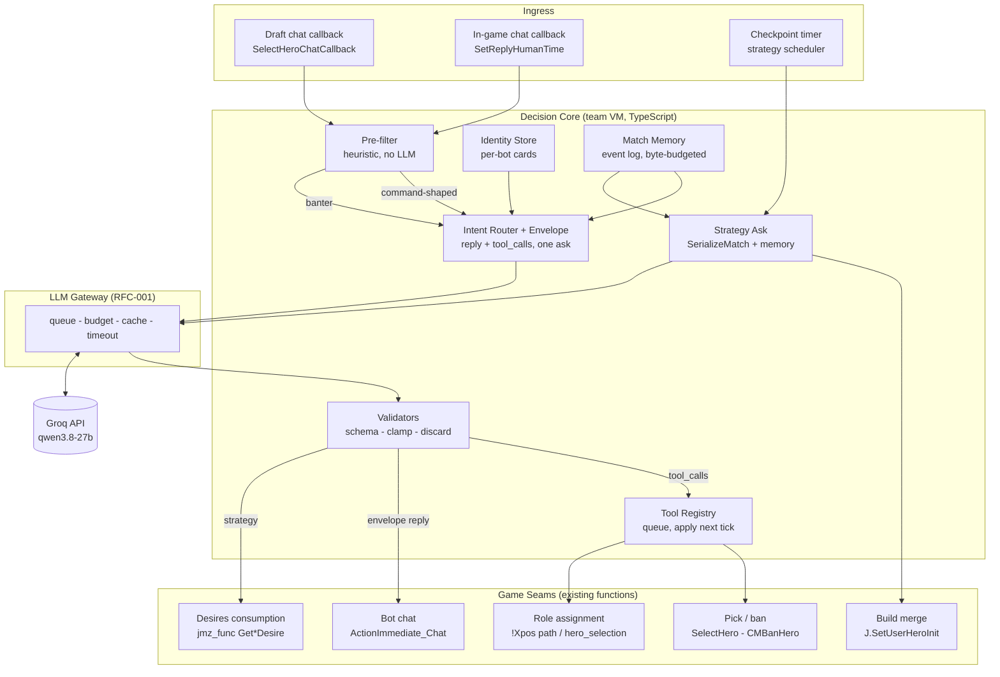
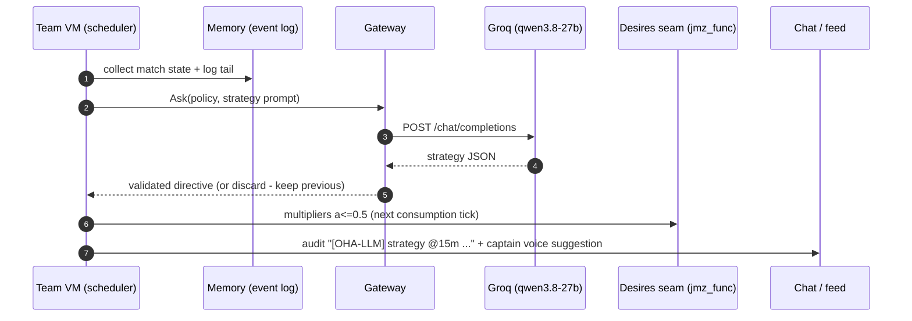
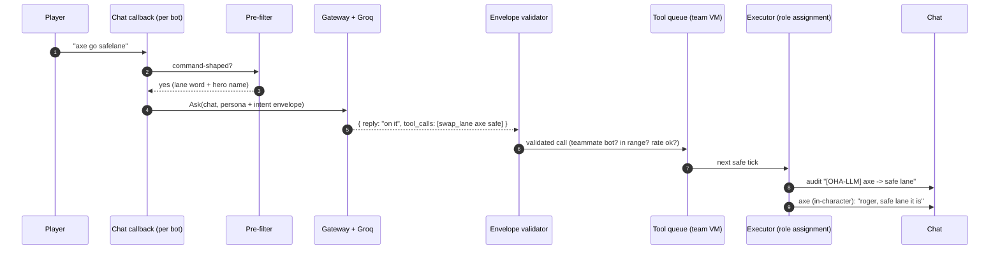

# RFC-002: Adaptive Strategy, Bot Identity, and Natural-Language Control

|                                              |                                                                                                                                                                                     |
| -------------------------------------------- | ----------------------------------------------------------------------------------------------------------------------------------------------------------------------------------- |
| **Status**                                   | APPROVED - owner green-light 2026-10-27; build order: identity (I) + cores first, strategy (A) follows; adaptive builds stay as shipped (RFC-001); mass-ulw program phase 1 running |
| **Date**                                     | 2026-10-27                                                                                                                                                                          |
| **Author**                                   | Maxxoto + agent                                                                                                                                                                     |
| **Extends**                                  | [RFC-001](2026-10-11-llm-adaptive-bots-design.md) - draft, builds, chat shipped                                                                                                     |
| **Decisions locked with owner (2026-10-27)** | Strategy first; identity is expression-only; memory v1 is per-match; intent router + tool calls confirmed; per-bot identity confirmed                                               |

## 1. Executive Summary

RFC-001 gave the bots an LLM advisor for drafts, builds, and chat - shipped and verified in lobbies. RFC-002 turns that advisor into a **decision-making system with a personality and a natural interface**:

1. **Adaptive team strategy** - the team re-plans at match checkpoints (push/defend/farm/Roshan weights), biased into Valve's existing desire system with hard clamps.
2. **Bot identity system** - every bot gets a stable per-match identity (name, archetype, voice, tilt curve). Chat, suggestions, and compliance lines are voiced in-character by that bot; machine audit lines stay clearly prefixed. Competence is never reduced.
3. **Natural-language control** - players type like humans (`"axe go safelane"`); an intent router + validated tool-call framework resolves the command against existing Dota 2 bot functions. Memorized `!commands` remain as a fallback.
4. **Per-match memory** - a byte-budgeted rolling event log feeds every subsequent ask, and later cross-match learning.

All of it ships dark behind `Allow_LLM_Advisor` (G5: disabled = byte-identical default behavior), reuses the proven gateway (queue/budget/cache/timeout), and logs every LLM decision to the visible channels established in RFC-001's deployment.

## 2. Background & Motivation

-   **Uniform bots.** All 10 bots share one voice and fixed heuristics; nothing distinguishes them or makes them feel human.
-   **Static strategy.** Push/defend/farm desires are Valve C++ defaults plus fixed OHA tuning; they do not react to how the match is actually going.
-   **Memorized commands.** Controlling bots requires manual syntax (`!3pos 4`); humans say `"axe go safelane"`.
-   **No memory.** Every ask starts from zero context; mid-game patterns (enemy 5-mans after 20 min) are invisible to the advisor.

RFC-001's substrate is already in production: gateway with phase budgets (12 policy / 30 chat), directive validators with whole-payload discard, chat persona with rate limiting, visible decision logging, and 44 offline tests plus live Groq round-trips.

## 3. Goals & Non-Goals

**Goals**

-   G1 - Team strategy adapts at bounded checkpoints, applied as clamped multipliers on existing desire seams.
-   G2 - Every bot has a distinct, stable identity that voices chat, suggestions, and tool-call compliance.
-   G3 - Natural chat is a first-class command interface via validated tool calls bound to existing game functions.
-   G4 - Every LLM decision is observable (audit line + in-character line) and every capability is individually toggleable.
-   G5 - Zero regression: layer off or failing => byte-identical default bot behavior.

**Non-Goals (v1)**

-   No per-frame LLM calls; no skill reduction from identity; no cross-match persistence (sketch only); no new endpoints beyond Groq; no training/fine-tuning.

## 4. System Architecture



**Messaging taxonomy** (how decisions surface):

| Channel      | Prefix / voice               | Examples                                                         |
| ------------ | ---------------------------- | ---------------------------------------------------------------- |
| Audit        | `[OHA-LLM]` system lines     | `strategy @15m: split-push (ask 3/8)`, `build axe (pos 3): ...`  |
| In-character | none - the bot itself speaks | `"on it, going safe"`, `"we should smoke mid, they're grouping"` |
| Silent state | overlay only                 | `[OHA-LLM] FORK ACTIVE gate=ON ...` (draft screen)               |

Audit lines are generated by the framework; in-character lines are generated by the bot's identity. Tool compliance and strategic suggestions are in-character; state changes are audited.

## 5. Workstream A - Adaptive Team Strategy

### 5.1 Checkpoint model

Fire-and-observe (never blocking), identical to the draft ask loop. A late or failed reply means the previous directive stays active.

| Checkpoint  | Trigger                        | Bound                                                                                                                                                                 |
| ----------- | ------------------------------ | --------------------------------------------------------------------------------------------------------------------------------------------------------------------- |
| C0          | post-draft (~0:00)             | read-only: seed multipliers from the existing cached draft directive if present - no new ask, no draft code (owner decision 2026-10-27: draft logic stays as shipped) |
| C1..Cn      | every 5 min game time          | max 8 strategy asks/game (policy 12 minus 2 draft)                                                                                                                    |
| event bonus | team wipe / Roshan / 3rd tower | consumes the next slot; cap never exceeded                                                                                                                            |

### 5.2 Ask & directive

Input: `SerializeMatch` (shipped, currently unused) - towers, K/D/A, enemy net worth and items, game time, lane pressures, memory notes. Output (`oha-strategy-v1`, whole-payload discard on any validation failure):

```json
{
    "schema": "oha-strategy-v1",
    "push": { "top": 0.0, "mid": 0.6, "bot": 0.3 },
    "defend": { "top": 0.2, "mid": 0.5, "bot": 0.2 },
    "farm": { "top": 0.3, "mid": 0.3, "bot": 0.4 },
    "rosh": 0.4,
    "stance": "split-push",
    "note": "enemy groups at 20, avoid 5v5"
}
```

Numerics clamped to [0,1]; `stance` is an enum used for announcements and identity framing only - never control flow.

### 5.3 Application seam (zero-regression decision)

The fork consumes Valve's C++ team desires at exactly one seam: the push/defend/farm aggregation in `jmz_func.lua` (~L3437). Strategy applies there: `effective = clamp(base * (1 - a) + directive * a)`, `a <= 0.5` - the same merge shape as draft scores. Gate off => identity multiplier.

**Rejected alternative:** implementing `team_desires.lua`. Overriding replaces the C++ defaults wholesale and scripts cannot read the would-be defaults back (circular `Get*Desire`) - an unacceptable regression surface for a bias feature.

### 5.4 Checkpoint sequence



## 6. Workstream F - Natural-Language Intent Router & Tool Framework

### 6.1 Design

Human chat is the command line. A heuristic pre-filter (lane words, hero names, imperative verbs - no LLM) decides whether a message is command-shaped; command-shaped messages route through the **same gateway ask the persona uses**, returning one envelope:

```json
{
    "schema": "oha-chat-envelope-v1",
    "reply": "on it",
    "tool_calls": [{ "tool": "swap_lane", "args": { "hero": "npc_dota_hero_axe", "lane": "safe" } }]
}
```

-   One call serves reply + intent - no extra budget.
-   Prompt-emitted JSON, validated like every directive; **no dependency on native function-calling** (model-agnostic; native tool-use is a later optimization if the model supports it).
-   Discard => no tool runs, optional local fallback (G5).

### 6.2 Tool registry - bound to existing Dota 2 functions

Each tool: name, arg schema, validator, executor, announcement. Executors enqueue into team-VM state and apply on the next safe tick - never inside a per-bot chat callback.

| Tool                                              | Args                     | Existing function invoked (v1)                                                |
| ------------------------------------------------- | ------------------------ | ----------------------------------------------------------------------------- |
| `swap_lane`                                       | hero, lane(safe/mid/off) | position 1/2/3 mapping -> the `!Xpos Y` role-assignment path (hero_selection) |
| `swap_position`                                   | hero, pos 1-5            | same role-assignment path                                                     |
| `suggest_pick` / `suggest_ban`                    | hero                     | `SelectHero` / ban list merge in the draft callback window                    |
| `group_up`, `push_focus`, `farm_priority` (later) | ...                      | compose on Workstream A multipliers                                           |

Validators: hero must be a teammate **bot** (never humans, never enemies), lane/pos in range, rate limit (~4 tool calls/game, 30 s cooldown). Draft window: the router also runs on the pick-phase callback so `"ban am and pick ls"` works as natural language.

### 6.3 Command sequence



## 7. Workstream I - Bot Identity System

### 7.1 Identity card

Seeded once per bot per game (deterministic per game seed; pure module `llm_identity_core.ts`), logged at spawn next to build announcements:

| Field          | Values / range                                  | Purpose                                     |
| -------------- | ----------------------------------------------- | ------------------------------------------- |
| `handle`       | derived from hero + suffix (e.g. "axe_enjoyer") | chat signature, attribution                 |
| `archetype`    | cocky / chill / whiny / strategist              | voice and suggestion style                  |
| `chattiness`   | 0..1                                            | per-bot reply chance (within global limits) |
| `tiltCurve`    | 0..1                                            | how fast tone shifts after deaths           |
| `timingJitter` | 0..1                                            | cosmetic response delay variance            |
| `catchphrases` | 2-3 seeded phrases                              | few-shot voice anchors in prompts           |

### 7.2 Where identity speaks

-   **Chat replies** - the persona prompt becomes per-bot (identity card in, voice out). Global rate limits (30 budget / 12 effective / 25 s cooldown) stay; identity only re-weights dice and tone.
-   **Tool compliance** - `"roger, safe lane it is"` instead of a bare audit line.
-   **Strategic suggestions** - Workstream A's checkpoint can emit a captain-bot in-character line (`"they keep grouping, let's split push"`) alongside the audit line - the humanized face of strategy.
-   **Event reactions** - first blood, spree, tower deaths, GG-call timing (extends today's local taunts with identity-voiced versions; local tables remain the fallback).

### 7.3 Hard boundary: expression only

Identity affects **what bots say and when** - never decision quality, mode selection, builds, or reaction speed on danger checks. Tilt changes tone, not thresholds. This is enforced structurally: identity data is only readable by the chat/announcement modules; the strategy, build, and ability modules have no import path to it.

## 8. Workstream C - Per-Match Memory

Byte-budgeted, append-only event log in `llm_state_core` (fixed slots, oldest evicted):

```
00:40 first_blood radiant
07:12 tower t1_bot dire
18:30 fight 4-1 dire (roshan)
20:05 enemy_group_5
26:44 item: enemy carry blink
```

Appended from existing seams (kill/death counters, tower/push logic, purchase observations) as one-line hooks. The log tail rides every strategy and chat ask (`memoryNotes` parameter already exists in the ask API). Patterns only ever bias suggestions - they never act alone.

## 9. Workstream D - Cross-Match Learning (deferred sketch)

Post-match summary JSON to gitignored `game/Customize/memory/` (per game mode); next match's asks read it. Gate: C's format proven across real matches. Later the seam for out-of-game `npm run learn` analysis.

## 10. Budgets, Latency, Safety

| Capability        | Budget                                   | Latency behavior                       |
| ----------------- | ---------------------------------------- | -------------------------------------- |
| Draft (shipped)   | 2/game                                   | 6 s grace on first pick, then defaults |
| Strategy (A)      | 8/game (policy 12)                       | non-blocking; previous directive holds |
| Chat + Router (F) | one ask/message, 12 effective, 30 budget | drop-on-slow; late tool call dropped   |
| Tools (F)         | ~4 executions/game                       | 30 s cooldown, teammate-bots-only      |

Safety: every envelope/tool validated (schema + authorization + rate); whole-payload discard; G5 identity multipliers; no PII beyond player names in prompts; audit line for every executed tool.

## 11. Roadmap & Acceptance Criteria

| Milestone            | Tasks                              | Acceptance criteria                                                                                                                                                                                               |
| -------------------- | ---------------------------------- | ----------------------------------------------------------------------------------------------------------------------------------------------------------------------------------------------------------------- |
| M1 Strategy (S1-S4)  | core+binding+seam+smoke            | lobby: `[OHA-LLM] strategy` lines each checkpoint; desires visibly shift post-wipe; `!llm status` shows strategy asks; G5 off = identical play. No draft work - existing draft adapter untouched (owner decision) |
| M2 Framework (F1-F4) | envelope+registry+router+executors | lobby: `"axe go safelane"` moves the bot; audit + compliance lines; `!3pos` still works; misroute (enemy hero / human) rejected with audit line                                                                   |
| M3 Memory (M1-M2)    | event log + injection              | roundtrip: strategy/chat prompts contain log tail; byte budget enforced in tests                                                                                                                                  |
| M4 Identity (H1-H2)  | cards + persona integration        | two bots answer the same message in distinct voices; catchphrases observable; zero change to non-chat behavior                                                                                                    |

Order: M1 -> M2 -> M3 -> M4 (memory enriches strategy+router; identity rides the finished chat stack last).

## 12. Risks & Mitigations

| Risk                                   | Mitigation                                                          |
| -------------------------------------- | ------------------------------------------------------------------- |
| Strategy bias weakens play             | a<=0.5 clamp, G5 kill switch, per-checkpoint audit, soak games      |
| Router misfires on banter              | strict pre-filter, tool rate limit, whole-envelope discard          |
| Identity drifts into offensive content | sanitizer rejects; archetype presets; no slurs rule in every prompt |
| Latency spikes on Groq                 | drop-on-slow everywhere; caches; per-phase budgets                  |
| Budget exhaustion early                | checkpoint caps; shared chat+router ask; cache keyed by message     |
| Native tool-use absent on model        | prompt-emitted JSON (already the design)                            |

## 13. Open Questions

1. Checkpoint cadence: 5 min fixed vs event-weighted slots (default: fixed, tune after soak).
2. Does `stance` influence identity tone or stay display-only? (default: display-only v1)
3. Memory eviction: oldest-first vs pinned anchor events (default: oldest-first).
4. Pre-filter strictness: miss commands vs spend asks on banter (default: strict).
5. Native tool-use availability on `qwen3.8-27b` (check in F1; design does not depend on it).

## 14. Appendix - Schemas

-   `oha-strategy-v1` - see §5.2.
-   `oha-chat-envelope-v1` - `{ reply?: string, tool_calls?: [{ tool: string, args: object }] }`, reply sanitized per `llm_chat_core.SanitizeChatReply`, tool args per registry schema.
-   Identity card - see §7.1; serialized into prompts under the state byte budget.
