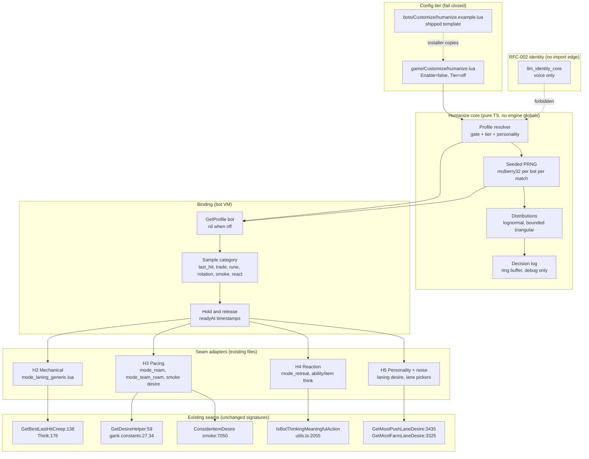
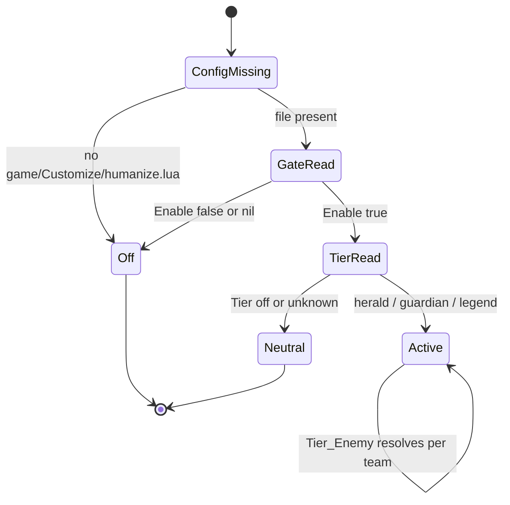
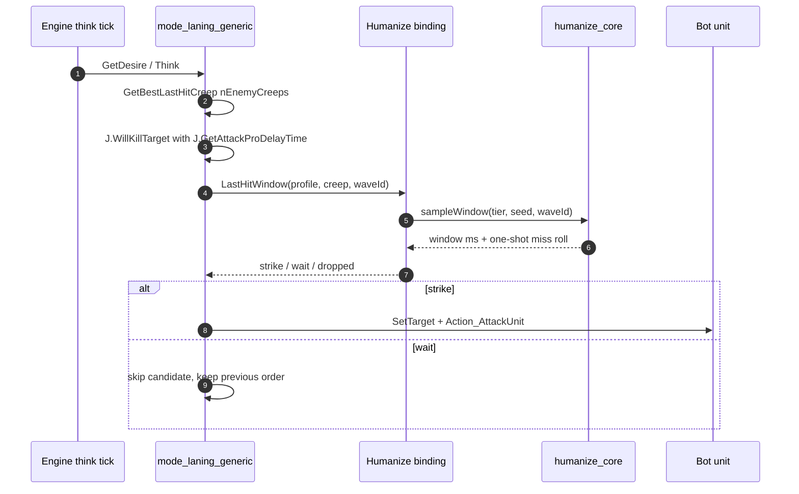
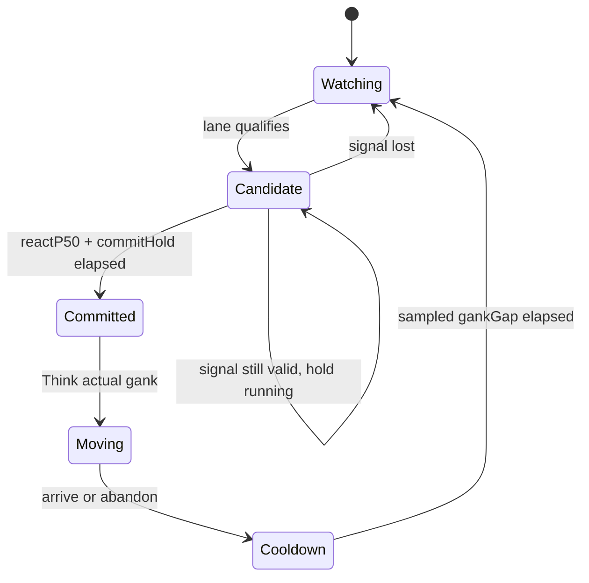
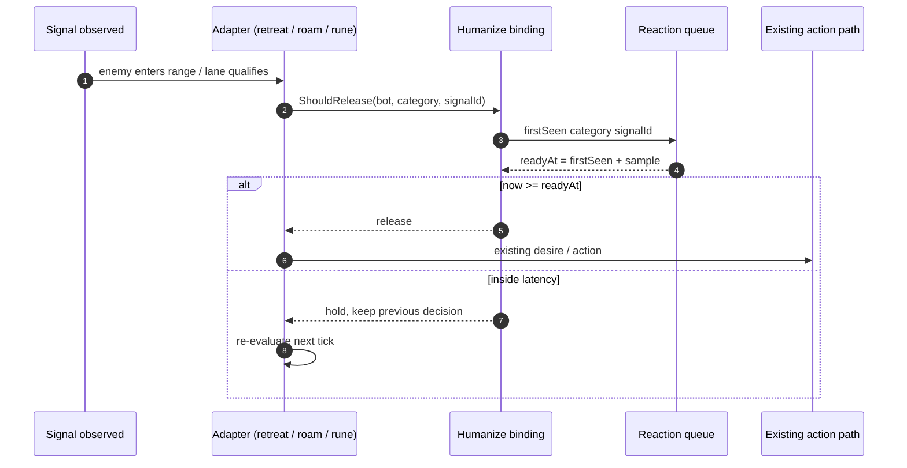
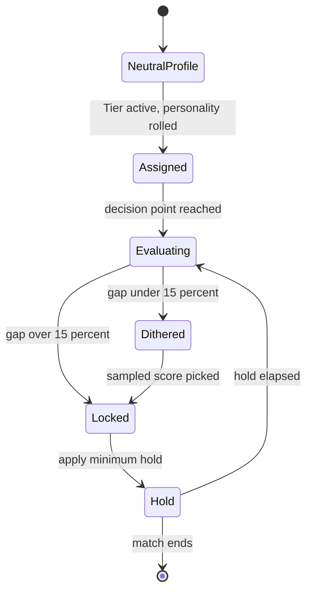

# RFC-003: Gameplay Humanization

|                             |                                                                                                                                                   |
| --------------------------- | ------------------------------------------------------------------------------------------------------------------------------------------------- |
| **Status**                  | **DRAFT** - design only, nothing implemented, no owner approval yet                                                                               |
| **Date**                    | 2026-10-27                                                                                                                                        |
| **Author**                  | Maxxoto + agent                                                                                                                                   |
| **Extends**                 | [RFC-002](2026-10-27-humanized-strategy-and-match-memory-design.md) (identity), [RFC-001](2026-10-11-llm-adaptive-bots-design.md) (LLM substrate) |
| **North star**              | Practice without MMR fear: a lobby that feels like playing ranked humans, with no consequence attached to the loss                                |
| **Hard constraint**         | G5 zero regression. Gate off, config missing, tier unset, or module error means the shipped bot behavior runs unchanged, byte for byte            |
| **Relationship to RFC-002** | RFC-002 changes what bots say. RFC-003 changes when and how loosely they act. The two never share a decision path                                 |

## Status

**DRAFT** (2026-10-27). Design only. Nothing here is implemented, and the owner has not approved a build. This document is open for review; the acceptance criteria in section 12 are the bar a future implementation has to clear.

## 1. Executive Summary

RFC-002 gave each bot a voice. The bots still play like machines: every last hit lands on the exact lethal tick, every gank starts the instant a lane looks soft, every smoke is cast the frame the item is ready. That crispness is the tell. Players feel it long before they can name it, and it makes a practice lobby feel like a drill instead of a game.

RFC-003 adds a **gameplay-level human-likeness layer** between the existing decision code and the engine:

1. **Mechanical rhythm variance** - last-hit timing curves, lane trade windows, and rune rotation timing get bounded, sampled jitter.
2. **Human pacing** - rotations, ganks, and smoke plays wait for a sampled reaction and commit window instead of firing on the first qualifying tick.
3. **Reaction latency profiles** - danger and opportunity signals pass through a per-bot latency sampled from a human percentile curve.
4. **Laning personalities** - each bot gets one of four laning temperaments (aggressive, cautious, greedy, supportive) that shifts existing lane weights.
5. **Skill-tier decision noise** - an opt-in tier (herald, guardian, legend) adds calibrated, bounded noise at named decision points. Unset means zero noise.

Every mechanism modifies a named existing function, cited with `path:line`. All of it sits behind one new Customize gate, `game/Customize/humanize.lua`, which ships disabled. The default profile is _neutral_: zero added delay, zero miss chance, zero noise, multiplier 1.0. A neutral profile takes the original code branch, not a randomized near-copy of it.

Identity composes without collision because the import graph forbids collision. RFC-002 identity data is readable only by chat and announcement modules. RFC-003 profile data is readable only by gameplay modules. Neither imports the other.

## 2. Background & Motivation

A custom lobby against these bots has one job: let a player practice the parts of Dota that ranked anxiety ruins. Trading in lane, contesting a rune, reacting to a rotation, committing to a smoke. The bots are competent enough to punish mistakes, which is exactly what makes the mechanical perfection exhausting.

Three observations drive the design:

-   **Perfect timing reads as unfair.** `GetBestLastHitCreep` attacks the first creep predicted to die to the current attack. A human misses some of those, attacks slightly early on others, and gets pushed off the wave by a trade. The result is a lane that feels scripted, even when the bot is not stronger.
-   **Instant commitment reads as inhuman.** `mode_roam_generic.lua` holds a gank decision for 30 s and enforces a 3 min gap, but the _decision moment_ is the first tick the lane looks gankable. Humans see the same signal, think about it, then move. That gap is most of what "reads as human" means.
-   **Bots never have a bad day.** Valve's desire system plus this fork's tuning produces a tight distribution of behavior. Human opponents have wide distributions: a herald player and a legend player differ in reaction time, trade discipline, and how often they pick the wrong lane.

The fork already has the plumbing this layer needs: `Customize.ThinkLess` throttling in `bots/Customize/general.lua:140`, shared decision helpers in `bots/FunLib/jmz_func.lua`, a pure-core plus binding pattern from RFC-001 (`llm_gateway_core.ts` -> `llm_gateway.ts`), and a config loader that fails closed (`typescript/bots/FunLib/llm_config.ts`). RFC-003 reuses all four patterns.

## 3. Goals & Non-Goals

**Goals**

-   G1 - A single neutral profile exists, and with it active every touched seam produces the pre-RFC behavior exactly.
-   G2 - Mechanical rhythm variance is bounded, seeded, and observable: last hits, trades, rune rotations.
-   G3 - Rotations, ganks, and smoke plays follow sampled human pacing distributions instead of first-tick commitment.
-   G4 - Reaction latency is per bot and tier-shaped, measured against stated percentile targets.
-   G5 - Zero regression: gate off, config absent, tier unset, or module error leaves default play untouched. This is the release gate, not a nice-to-have.
-   G6 - Every mechanism is individually switchable and every decision is traceable to a profile value.
-   G7 - Composes with RFC-002 identity without any shared decision data or import edge.

**Non-Goals (v1)**

-   No LLM calls. This layer is local, deterministic, and cheap. RFC-002 keeps the network budget.
-   No reduction of ability, item, or build correctness. A bot may mistime a last hit; it will not forget to use BKB.
-   No humanization of danger checks (retreat, buyback, glyph) in v1. Those stay exact.
-   No cross-match learning, no player modeling, no per-player opponent profiles.
-   No change to FretBots bonus math, difficulty voting, or neutral item tables.
-   No behavior change for human-controlled units.
-   No new game modes and no new engine calls.

## 4. System Architecture



**Layer contract**

| Layer       | May read                              | May write                    | Must never                      |
| ----------- | ------------------------------------- | ---------------------------- | ------------------------------- |
| Core (pure) | config values, seed, tier, timestamps | sampled values, decision log | touch `bot`, engine globals     |
| Binding     | core, `Customize`, the bot unit       | per-bot profile cache        | call `Action_*`                 |
| Adapters    | binding, existing mode state          | existing `Action_*` calls    | invent a second decision engine |
| Identity    | chat and announcement modules         | speech                       | import humanize, read profiles  |

**Neutrality rule.** `Humanize.GetProfile(bot)` returns `nil` unless the gate is on and the tier resolves to a known value. Every adapter starts with `if not p then <original body> end`. A `nil` profile means the RNG is never constructed, no timestamps are stored, and the code path is the one that ships today.

**Determinism.** The PRNG seed is derived once per bot per match from `bot:GetPlayerID()`, the team, and the match start tick, then kept in the binding's per-bot cache. Same lobby, same inputs, same samples. Replays and the regression harness depend on this.

## 5. Composition with RFC-002 Identity and the G5 Boundary

RFC-002 makes a claim that matters here: identity is expression only. Its data is readable by chat, suggestion, and announcement modules, and by nothing else. RFC-003 keeps that claim intact and adds its mirror image.

| Concern         | RFC-002 identity                          | RFC-003 humanization                         |
| --------------- | ----------------------------------------- | -------------------------------------------- |
| Changes         | words, tone, timing of speech             | timing and looseness of actions              |
| Data            | handle, archetype, chattiness, tilt curve | tier, personality, latency, noise amplitude  |
| Read by         | `llm_chat*`, announcement paths           | laning, roam, rune, item usage, lane pickers |
| Never read by   | any mode or ability module                | any chat or identity module                  |
| Effect when off | default local lines                       | byte-identical default play                  |
| Shared decision | none                                      | none                                         |

**Enforcement, not etiquette.** The import rule is checkable. A test asserts that `typescript/bots/FunLib/humanize*.ts` has no import of `llm_identity_core`, and that `llm_chat*.ts` and `llm_identity_core.ts` have no import of `humanize`. A code review checklist item alone would rot; the test won't.

**Where the two meet.** Only in presentation. A bot with an aggressive laning personality may also have a cocky archetype, but the assignment is independent. If both are enabled, the player sees a cocky bot that actually plays forward. The coupling is narrative, not mechanical, and that's deliberate.

**G5 proof.** Three checks gate release:

1. **Static:** with `Enable = false`, no adapter can obtain a profile. A Lua harness loads the touched mode files with a stub bot, runs `GetDesire` and `Think` for a fixed script of ticks, and diffs the recorded action calls against a baseline snapshot taken before the change.
2. **Unit:** `humanize_core` tests assert neutral inputs return identity values (delay 0, miss 0, multiplier 1, noise 0).
3. **Lobby:** one game with the gate off, one with it on but `Tier = "off"`, and one with a tier. The first two must look the same to the player and produce the same audit counters.

## 6. Phase H1 - Profile Layer and Gate

This phase ships no gameplay change. It exists so every later phase has one place to ask "is this bot humanized, and how much?"

### 6.1 Config surface

New file `game/Customize/humanize.lua`, created by the installers from `bots/Customize/humanize.example.lua`. It is permanent-tier, gitignored, and separate from `general.lua` so it can't inherit the generated-config parity problem.

```lua
return {
    Enable = false,          -- master gate, default off
    Tier = "off",            -- "off" | "herald" | "guardian" | "legend"
    Tier_Enemy = nil,        -- optional separate tier for the opposing team
    Personalities = true,    -- laning temperaments when Tier is active
    Debug = false,           -- one audit line per sampled decision
}
```

Values are validated field by field, mirroring `typescript/bots/FunLib/llm_config.ts`: unknown keys are ignored, invalid values fall back to the neutral default, nothing throws. A bad config file must never take bots offline.

### 6.2 Profile resolution



`Off` and `Neutral` are behaviorally identical and differ only in the debug banner. `Neutral` is useful when a player wants the plumbing present but no effect. Both return `nil` from `GetProfile`.

### 6.3 Profile fields

| Field           | Type / range | Meaning                                         |
| --------------- | ------------ | ----------------------------------------------- |
| `tier`          | enum         | Drives latency, miss chance, noise amplitude    |
| `personality`   | enum         | aggressive, cautious, greedy, supportive        |
| `seed`          | uint32       | Seeded per bot per match                        |
| `reactP50Ms`    | 0..1200      | Median reaction to a newly observed signal      |
| `reactSigma`    | 0.05..0.6    | Log-normal spread for the reaction sample       |
| `missLastHit`   | 0..0.15      | Per-wave probability of one dropped last hit    |
| `tradeAppetite` | 0..1         | Probability of taking an available trade window |
| `runePriority`  | 0..1         | Weight applied to rune desire, bounded          |
| `noiseAmp`      | 0..0.2       | Fractional dither at named decision points      |
| `commitHoldMs`  | 0..1500      | Extra hold before a rotation or smoke commits   |

### 6.4 Gate states in the engine

The binding is a small Lua module generated from `typescript/bots/FunLib/humanize.ts`, with the pure logic in `typescript/bots/FunLib/humanize_core.ts`. Mode files require it once at the top:

```lua
local Humanize = require(GetScriptDirectory()..'/FunLib/humanize')
```

Because the module always ships, a missing file is an install fault, not a runtime branch. `GetProfile` failing closed covers config faults instead. Phase H1 acceptance includes `npm run build:lua` producing `bots/FunLib/humanize.lua` and `bots/FunLib/humanize_core.lua` with no uncommitted drift.

## 7. Phase H2 - Mechanical Rhythm Variance

### 7.1 Last-hit timing curves

**Exact seam:** `bots/mode_laning_generic.lua:138` `GetBestLastHitCreep`, called from `GetDesire` at `:100` and `Think` at `:176`. The lethal prediction uses `J.WillKillTarget` with `nDelay` from `J.GetAttackProDelayTime` (`bots/FunLib/jmz_func.lua:2064`).

Today the function returns the first creep whose predicted death falls inside the current attack. The humanized version adds a sampled **comfort window**:

-   Compute the same lethal prediction the code already computes.
-   Sample a window `w` in milliseconds from the tier curve. The bot strikes when predicted death falls inside `[0, w]` instead of exactly at `0`.
-   With probability `missLastHit`, suppress one candidate for this creep wave, then clear the flag. Bounded to one drop per wave and never applied to denies.
-   Never apply the window when the bot is the only core in lane and the creep would otherwise be denied by an enemy hero. Losing a last hit to an enemy is a real loss; losing it to noise is a bug.

**Exact seam for denies:** `bots/mode_laning_generic.lua:160` `GetBestDenyCreep` stays neutral in v1.

**No sleeps.** The window is evaluated against predicted kill timing on the engine's existing think tick. No timers, no coroutines, no delayed callbacks. Missing the window simply means the candidate is skipped this tick, which the mode already handles.



### 7.2 Trade windows

**Exact seam:** `bots/mode_laning_generic.lua:176` `Think`, which currently dispatches three things in order: last hit, deny, walk to lane front. The scan list already exists as `nInRangeEnemy` from `GetDesire:41` (`GetNearbyHeroes(1600, true, BOT_MODE_NONE)`).

A humanized trade branch slots between deny and lane-front movement:

-   Eligible only when the enemy hero is within attack range plus 200, no enemy tower aura covers the bot, and allied lane creeps are at least one short of enemy creeps.
-   `tradeAppetite` is rolled once per enemy hero per 10 s window, not per tick.
-   On commit, the bot attacks for a sampled window (1.2 s to 2.6 s by personality) and then disengages by walking to the lane front. This mirrors how a human trades and backs off instead of holding attack-move.
-   Never fires below the personality's HP floor, and never during a last-hit window that is already ready.

The personality table (Phase H5) supplies the appetite and the HP floor. The branch calls the same `bot:Action_AttackUnit` path the rest of the file uses.

### 7.3 Rune rotation timing

**Exact seams:** `bots/mode_rune_generic.lua:59` `GetDesire`, `:249` `Think`, `:654` `X.GetGoOutLocation`, `:707` `X.IsTeamMustSaveRune`.

Three timings change, each with a hard invariant:

| Timing             | Change                                                                       | Invariant                                                                 |
| ------------------ | ---------------------------------------------------------------------------- | ------------------------------------------------------------------------- |
| Departure for rune | Add a sampled delay to `X.GetGoOutLocation` departure                        | Arrival stays before spawn; delay never exceeds existing slack            |
| Reaction to spawn  | Gate the desire bump behind `reactP50Ms` for the tier                        | Contested rune check still wins over the delay                            |
| Contest vs concede | `runePriority` scales the desire return, bounded to plus or minus 15 percent | Enemy-outnumber and recent-damage guards at `:80` to `:92` stay untouched |

The wisdom-rune branch returns `BOT_MODE_DESIRE_ABSOLUTE` today. It keeps that value. Humanization shapes _approach timing_, not the decision to contest a rune the team has committed to. Skipping wisdom because a dice roll said so would be a competence regression dressed as realism.

## 8. Phase H3 - Human Pacing for Rotations, Ganks, and Smoke

### 8.1 Rotation and gank commitment

**Exact seams:** `bots/mode_roam_generic.lua:51` `GetDesire`, `:59` `GetDesireHelper`, constants `gankDecisionHoldTime` at `:27` and `gankGapTime` at `:34`, the lane-target decision at `:1020` to `:1101` inside `ThinkActualGankingInLanes` (`:955`). The team-wide variant is `bots/mode_team_roam_generic.lua:72` `GetDesire` and `:295` `Think`.

The constants become seeded per-bot samples, not per-tick rolls:

-   `gankDecisionHoldTime`: 30 s base, sampled in 22 to 38 s by personality (aggressive low, cautious high).
-   `gankGapTime`: 180 s base, sampled log-normal with a 150 s median and 40 s sigma, clamped to 90 to 300 s.
-   A new **observation hold** sits in front of the commit at `:1101`: after the lane first qualifies, the bot waits `reactP50Ms + commitHoldMs` before setting `lastGankDecisionTime`. If the lane stops qualifying during the hold, the candidate is dropped and the hold resets.

That last rule is the point of the phase. A human doesn't teleport on the first frame a lane looks gankable. They watch it for a beat, then go.



### 8.2 Smoke timing

**Exact seam:** `bots/ability_item_usage_generic.lua:7050`, `X.ConsiderItemDesire['item_smoke_of_deceit']`.

The desire function already checks nearby enemies, towers, and whether allies are grouped. Humanization adds a **gather window** before the cast:

-   When the existing conditions first pass, stamp `smokeReadyAt = DotaTime() + commitHoldMs + sampleGather(tier)`.
-   Return high desire only after the group has stayed formed (allies within 1200) for that window. If the group breaks, clear the stamp.
-   Defensive smoke, defined as any case where an enemy hero is already inside 1200, bypasses the gather window entirely. Casting late there loses fights, and a lost fight is not a personality trait.
-   One smoke attempt per sampled cooldown (45 to 90 s). The item's own cooldown still applies.

### 8.3 Objective and lane switching

**Exact seams:** `bots/FunLib/jmz_func.lua:3435` `J.GetMostPushLaneDesire`, `:3325` `J.GetMostFarmLaneDesire`, `:3374` `J.GetDefendLaneDesire`.

These functions pick a lane by comparing three desire values with strict `>` comparisons. Humanization adds hysteresis, not randomness, in v1: a switch only happens when the new lane beats the current lane by a tier-scaled margin (2 percent legend, 6 percent guardian, 10 percent herald). This kills the lane oscillation that perfect comparisons can produce and costs nothing when the margin is unset.

## 9. Phase H4 - Reaction Latency Profiles

### 9.1 Model

Reaction latency is the delay between a signal becoming visible and the bot acting on it. It is not a think-rate throttle. `Customize.ThinkLess` already throttles how often the fork recomputes; stacking a second throttle on top would double-count. Instead, the binding holds a **release time** per bot per signal category and lets the existing logic keep evaluating.

| Category      | Examples                                       | v1 latency?         |
| ------------- | ---------------------------------------------- | ------------------- |
| `danger`      | enemy hero enters range while bot is low       | yes                 |
| `opportunity` | enemy out of position, rune spawn, gank window | yes                 |
| `objective`   | tower pressure flips, Roshan window            | yes, half amplitude |
| `reflex`      | retreat below HP floor, buyback, glyph         | no, exact           |

The third row matters. Some decisions should stay fast because a late one is indistinguishable from a broken bot. The layer's credibility dies the first time a legend-tier bot stands in a Chronosphere.

### 9.2 Percentile targets

Starting points, to be calibrated in soak. Treat them as design inputs, not measured facts.

| Tier     | p50  | p90  | Miss chance on opportunity | Notes                                 |
| -------- | ---- | ---- | -------------------------- | ------------------------------------- |
| off      | 0 ms | 0 ms | 0 percent                  | neutral                               |
| legend   | 270  | 420  | 4 percent                  | reacts close to the current bot speed |
| guardian | 340  | 560  | 10 percent                 | visible pause on rotations            |
| herald   | 420  | 700  | 20 percent                 | late to fights, still last-hits       |

Samples come from a log-normal with median `reactP50Ms` and spread `reactSigma`, clamped to the p99 so a tail sample cannot exceed 1.2 s. Each signal category gets its own sample; a bot that reacts fast to a rune and slow to a gank feels more like a person than one with a single fixed delay.

### 9.3 Seams

| Seam                                                           | Change                                                               |
| -------------------------------------------------------------- | -------------------------------------------------------------------- |
| `bots/mode_retreat_generic.lua:120` `GetDesire`                | Danger release gate before the retreat desire is raised              |
| `bots/mode_roam_generic.lua:59` `GetDesireHelper`              | Opportunity release gate, shared with Phase H3's hold                |
| `bots/mode_rune_generic.lua:59` `GetDesire`                    | Opportunity gate on rune desire, never on the wisdom absolute branch |
| `bots/FunLib/jmz_func.lua:4676` `J.WeAreStronger`              | Read-only threshold; the caller applies the gate, not this function  |
| `bots/ability_item_usage_generic.lua:8507` `ItemUsageThink`    | Optional item response gate for defensive items only                 |
| `bots/ability_item_usage_generic.lua:8516` `AbilityUsageThink` | Optional ability response gate, tier-scaled, capped at 120 ms        |

**Interaction with ThinkLess.** `typescript/bots/FunLib/utils.ts:2055` `IsBotThinkingMeaningfulAction` caches for `0.11 * thinkLess` seconds, and `ability_item_usage_generic.lua:8507` and `:8516` gate on `bot.frameProcessTime * (1 + Customize.ThinkLess)`. Humanization adds its delay _after_ those gates, and the binding sums the two budgets against one cap. If `ThinkLess` is high, humanization's added delay shrinks so the total stays under the tier's p90. Two throttles must never multiply into a stun.



### 9.4 Signal identity

A signal needs a stable id or the bot re-samples the same event every tick and never releases. The binding keys on category plus a coarse signature: enemy player id, lane, and a 2 s bucket. Re-observing the same signature keeps the original `readyAt`. A genuinely new event (different enemy, different lane, later bucket) gets a fresh sample. This is the difference between a pause and a freeze.

## 10. Phase H5 - Laning Personalities and Skill-Tier Decision Noise

### 10.1 Personalities

Four temperaments, assigned once per bot per match from the seeded PRNG. They modulate existing lane weights rather than adding new modes.

| Personality | Last-hit window | Trade appetite | HP floor | Rune priority | Rotation willingness |
| ----------- | --------------- | -------------- | -------- | ------------- | -------------------- |
| aggressive  | tight           | 0.75           | 0.35     | 0.6           | high                 |
| cautious    | wide            | 0.25           | 0.60     | 0.4           | low                  |
| greedy      | tight           | 0.35           | 0.30     | 0.5           | very low             |
| supportive  | wide            | 0.45           | 0.50     | 0.8           | high                 |

**Exact seams:** `bots/mode_laning_generic.lua:32` `GetDesire` (the level and time desire ladder returns 0.268, 0.446, 0.369, 0.2, 0.01), `:138` `GetBestLastHitCreep` (window and miss), `:160` `GetBestDenyCreep` (stays neutral), `:176` `Think` (trade branch and lane-front walk). Rune priority touches `bots/mode_rune_generic.lua:59`.

Team composition gets one guard: assign personalities so a team has at most two of the same temperament and at least one cautious or supportive bot. Five greedy carries is a comedy sketch, not a practice partner.

### 10.2 Decision noise per tier

Noise applies at named decision points only, and only when the top two options are already close. That keeps it from overriding a clearly correct choice.

| Decision point            | Seam                                                    | Noise shape                                         |
| ------------------------- | ------------------------------------------------------- | --------------------------------------------------- |
| Which lane to push        | `jmz_func.lua:3435` `GetMostPushLaneDesire`             | plus or minus `noiseAmp`, applied to runner-up only |
| Which lane to farm        | `jmz_func.lua:3325` `GetMostFarmLaneDesire`             | same                                                |
| Which lane to defend      | `jmz_func.lua:3374` `GetDefendLaneDesire`               | half amplitude, defense stays sticky                |
| Which lane to gank        | `mode_roam_generic.lua:955` `ThinkActualGankingInLanes` | one-shot dither on the candidate score              |
| Whether to contest a rune | `mode_rune_generic.lua:59` `GetDesire`                  | bounded by `runePriority`, never on wisdom          |

Rules:

-   Noise fires only when the score gap is under 15 percent. Above that, the correct choice is not a coin flip.
-   A decision latches for a minimum hold (8 s for lanes, 20 s for ganks) so noise cannot cause thrash.
-   `noiseAmp` is zero when the tier is unset. Herald 0.18, guardian 0.10, legend 0.04.
-   Danger decisions (`J.IsRetreating` at `jmz_func.lua:1523`) are excluded in v1.



### 10.3 Difficulty neutrality

"Difficulty-neutral default" means three things, and all three are testable:

1. Gate off or tier unset changes nothing. The neutral profile has no effect at any seam.
2. A tier is a _shape_, not a handicap applied to one side. Both teams get the same tier unless `Tier_Enemy` says otherwise, so win rate stays near 50 percent by construction.
3. The tier's expected effect on win rate against the neutral profile stays within plus or minus 3 percentage points over a 20-game soak. If it drifts further, the tier is mis-calibrated and ships off.

Herald is not "easier bots get dumber in fights". It is a wider timing distribution and more noise on lane choices. The bots still use their items, still retreat, still take free objectives. That keeps the lobby useful for practice at every tier.

## 11. Observability and Test Strategy

**Visible surface.** One chat line per match when the layer is active, via the existing chat publisher path used by RFC-002 announcements: `[OHA-HUM] tier=guardian profile=axe:aggressive seed=...`. With `Debug = true`, each sampled decision appends to a ring buffer and prints at most one line every 5 s. No per-tick spam, ever.

**Offline tests.** `test/humanize_core.test.ts` covers:

-   Neutral profile returns identity values for every sampler.
-   Seeded PRNG is stable across runs and independent per bot.
-   Log-normal samples stay inside the clamp for 100k draws.
-   Noise never fires above the 15 percent gap threshold.
-   Latency sum with `ThinkLess` never exceeds the tier p90.
-   Import-boundary test: no humanize to identity edge, no identity to humanize edge.

**Lua harness.** A stub bot loads the touched mode files and replays a fixed 10-minute tick script. Two runs are compared: baseline (pre-change) and gate off. Action calls must match exactly. A third run with `Tier = "guardian"` must differ in at least the expected categories and never in the `reflex` category.

**Build discipline.** `npm run build:lua` runs before any verification claim, and the generated `bots/FunLib/humanize.lua`, `humanize_core.lua` ship in the same commit as their TypeScript source.

## 12. Roadmap & Acceptance Criteria

| Milestone                       | Scope                                                        | Acceptance criteria                                                                                                                                                                                               |
| ------------------------------- | ------------------------------------------------------------ | ----------------------------------------------------------------------------------------------------------------------------------------------------------------------------------------------------------------- |
| M1 Profile and gate (H1)        | `humanize_core.ts`, `humanize.ts`, config example, installer | Gate off returns nil at every seam; `[OHA-HUM]` banner prints when active; `npm test` green; `npm run build:lua` clean; neutral profile produces baseline action trace                                            |
| M2 Mechanical rhythm (H2)       | last hit window, trade branch, rune timing                   | Lobby: herald profile drops 3 to 8 percent of last hits, guardian 2 to 5, legend 0 to 3; denies unchanged; no missed wisdom contest; baseline trace with tier off is byte-identical                               |
| M3 Reaction latency (H4)        | release queue, danger and opportunity gates                  | Measured hold matches tier p50 within 10 percent across 200 signals; `reflex` category unchanged; ThinkLess interaction stays under p90; low-HP retreat still fires                                               |
| M4 Human pacing (H3)            | gank hold, gank gap, smoke gather, lane hysteresis           | Gank gap p50 within 15 percent of sampled target; smoke casts only after group holds; lane switches drop versus baseline; defensive smoke adds no delay                                                           |
| M5 Personalities and noise (H5) | temperament assignment, tier noise, lane pickers             | Two bots with different temperaments show distinct trade counts in one game; noise never fires above the gap threshold; 20-game soak within plus or minus 3 points win rate versus neutral; tiers order correctly |

Order: M1 -> M2 -> M3 -> M4 -> M5. Reaction latency lands before pacing because pacing reuses its release queue. Personalities land last because they modulate every earlier seam.

## 13. Risks & Mitigations

| Risk                                           | Mitigation                                                                                             |
| ---------------------------------------------- | ------------------------------------------------------------------------------------------------------ |
| Bots feel worse, not human                     | Amplitude caps per tier, p99 clamps, 20-game soak, one-line kill switch                                |
| Dropped last hits lose games                   | One drop per wave, no denies, no drops on uncontested free farm, tier miss caps                        |
| Latency stacks with ThinkLess and freezes bots | Single summed budget, cap at tier p90, no latency in `reflex` category                                 |
| Noise causes lane thrash                       | Gap threshold, minimum hold, latching                                                                  |
| Identity and humanization drift into one layer | Import-boundary test, separate config files, separate review checklist                                 |
| Mixed human and bot lobby gets unfair          | Same tier both sides by default, `Tier_Enemy` explicit, bots only                                      |
| Config typo takes bots offline                 | Field-by-field validation, fail closed, no throws                                                      |
| Per-tick sampling costs frames                 | Profile cached once, samplers O(1), no per-tick RNG in the neutral path                                |
| Replays diverge                                | Seeded PRNG, stable signal ids, deterministic samples                                                  |
| Players can't tell it's on                     | `[OHA-HUM]` banner, debug ring buffer, README section with the tier table                              |
| Feature creeps into danger decisions           | Explicit exclusion list for retreat, buyback, glyph; a test asserts those seams never call the binding |

## 14. Open Questions

1. Should the shipped example default to `Tier = "off"` with `Enable = true`, so players flip one value, or keep `Enable = false` and require two edits? The G5 requirement says the shipped default must be off; the exact ergonomics are open.
2. One lobby-wide tier, or a tier per team? `Tier_Enemy` exists in the schema but v1 could ignore it.
3. Where do the percentile targets come from? Human Benchmark medians are a starting reference; in-house measurement in custom lobbies would be better.
4. Should herald keep perfect denies? Denies are a skill signal, and dropping them might read as more human, but they also protect lane equilibrium.
5. Does humanization belong in FretBots mode at all, where bonuses already distort difficulty? Default: yes, but only when a tier is explicitly set.
6. Should the player be able to pin a personality to a named bot ("make axe aggressive")? That is a natural extension of RFC-002's identity cards, and it needs a UI story first.
7. Is a 20-game soak enough to trust a plus or minus 3 point win-rate band, or does this need 100 games per tier?
8. Do we expose the profile in the `!llm status` reply, a new `!hum status` command, or both?

## 15. Appendix - Schemas and Seam Map

**Config schema.** See §6.1. Validation mirrors `typescript/bots/FunLib/llm_config.ts`.

**Profile schema.** See §6.3. Serialized nowhere; it is built in memory and cached per bot.

**Seam map (complete v1 list).**

| Mechanism         | File and line                                   | Function                                     | Neutral behavior          |
| ----------------- | ----------------------------------------------- | -------------------------------------------- | ------------------------- |
| Last hit          | `bots/mode_laning_generic.lua:138`              | `GetBestLastHitCreep`                        | original first-lethal hit |
| Last hit callers  | `bots/mode_laning_generic.lua:100`, `:176`      | `GetDesire`, `Think`                         | unchanged                 |
| Deny              | `bots/mode_laning_generic.lua:160`              | `GetBestDenyCreep`                           | unchanged (v1)            |
| Trade             | `bots/mode_laning_generic.lua:176`              | `Think`                                      | no trade branch           |
| Rune departure    | `bots/mode_rune_generic.lua:654`                | `X.GetGoOutLocation`                         | original timing           |
| Rune desire       | `bots/mode_rune_generic.lua:59`                 | `GetDesire`                                  | original values           |
| Gank hold and gap | `bots/mode_roam_generic.lua:27`, `:34`, `:1020` | constants, `ThinkActualGankingInLanes`       | 30 s and 180 s            |
| Team roam         | `bots/mode_team_roam_generic.lua:72`, `:295`    | `GetDesire`, `Think`                         | unchanged                 |
| Smoke             | `bots/ability_item_usage_generic.lua:7050`      | `ConsiderItemDesire['item_smoke_of_deceit']` | immediate cast            |
| Retreat reaction  | `bots/mode_retreat_generic.lua:120`             | `GetDesire`                                  | immediate                 |
| Think throttle    | `typescript/bots/FunLib/utils.ts:2055`          | `IsBotThinkingMeaningfulAction`              | unchanged                 |
| Item think        | `bots/ability_item_usage_generic.lua:8507`      | `ItemUsageThink`                             | unchanged                 |
| Ability think     | `bots/ability_item_usage_generic.lua:8516`      | `AbilityUsageThink`                          | unchanged                 |
| Push lane pick    | `bots/FunLib/jmz_func.lua:3435`                 | `GetMostPushLaneDesire`                      | strict comparison         |
| Farm lane pick    | `bots/FunLib/jmz_func.lua:3325`                 | `GetMostFarmLaneDesire`                      | strict comparison         |
| Defend lane pick  | `bots/FunLib/jmz_func.lua:3374`                 | `GetDefendLaneDesire`                        | strict comparison         |
| Retreat helper    | `bots/FunLib/jmz_func.lua:1523`                 | `IsRetreating`                               | excluded from noise       |
| Strength helper   | `bots/FunLib/jmz_func.lua:4676`                 | `WeAreStronger`                              | read-only threshold       |
| Attack delay      | `bots/FunLib/jmz_func.lua:2064`                 | `GetAttackProDelayTime`                      | unchanged                 |
| ThinkLess         | `bots/Customize/general.lua:140`                | `Customize.ThinkLess`                        | 1                         |

**Files to add.** `typescript/bots/FunLib/humanize_core.ts`, `typescript/bots/FunLib/humanize.ts`, `bots/Customize/humanize.example.lua`, `test/humanize_core.test.ts`. **Files to modify.** The mode and helper files in the seam map, plus the installer scripts that create `game/Customize/humanize.lua` from the example. No other file changes in v1.
